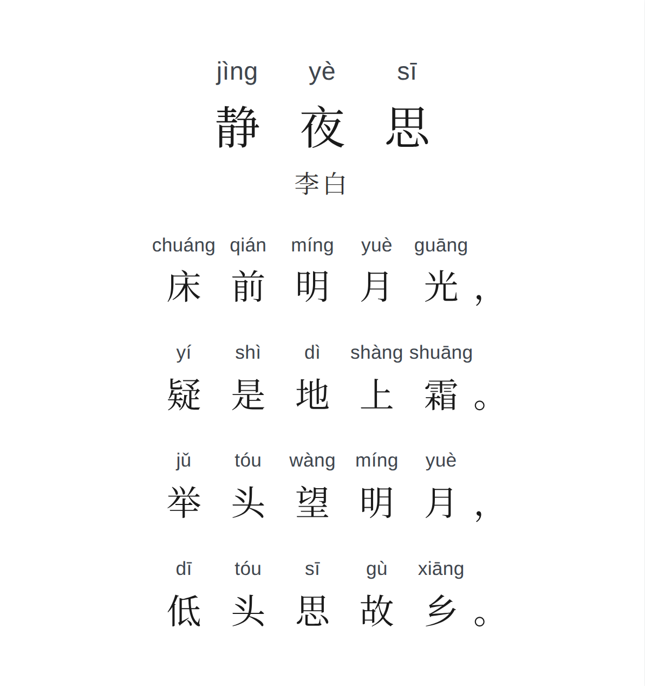
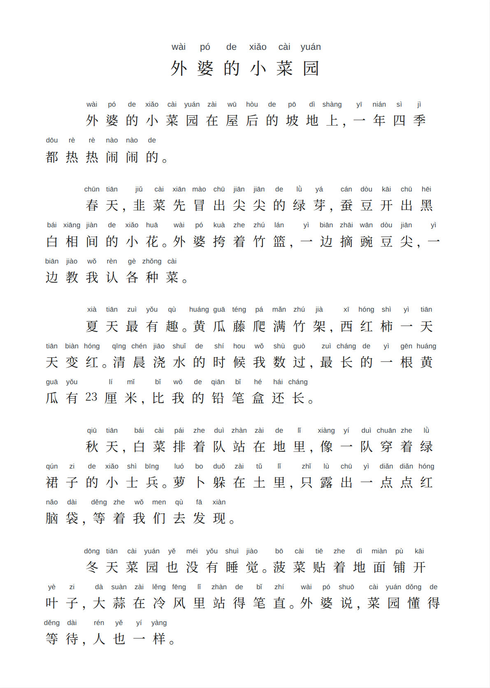
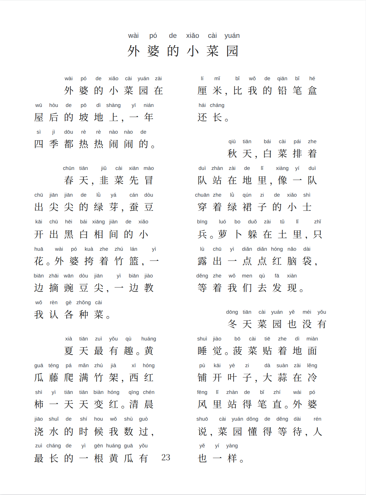
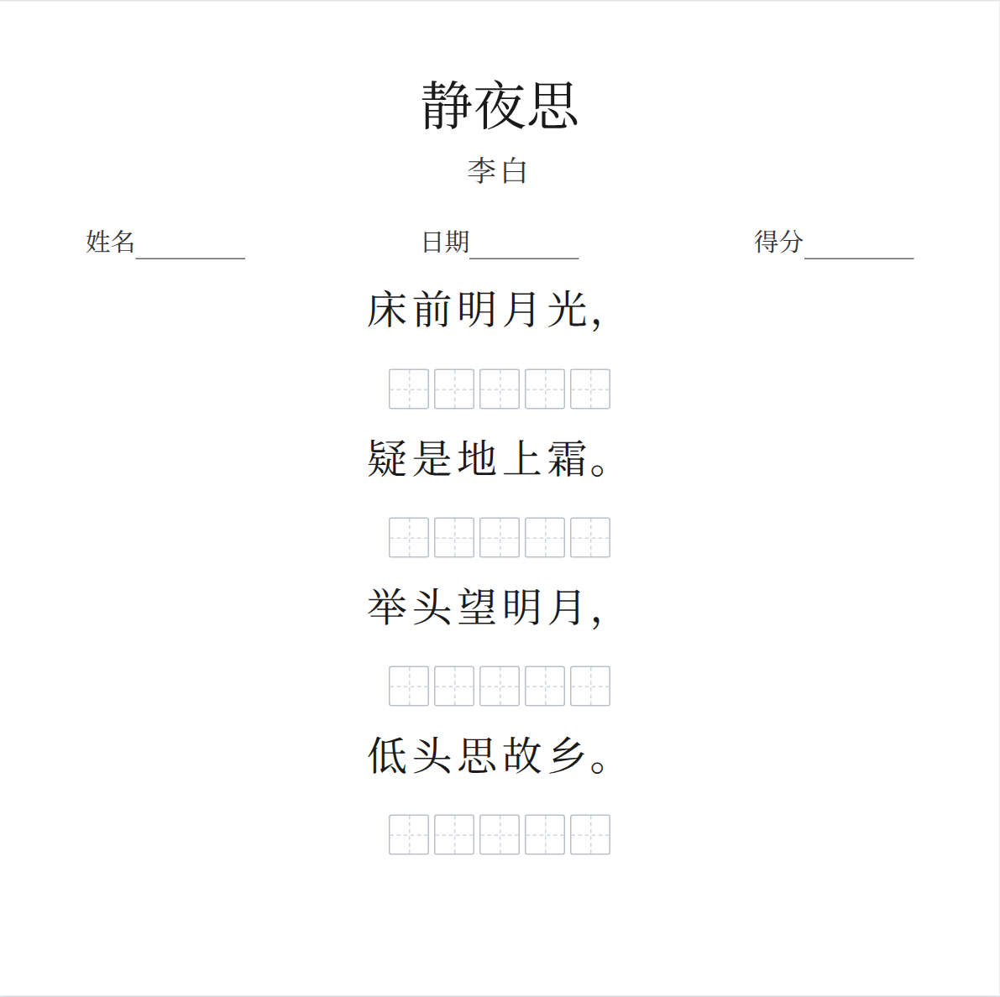

# Chinese Pinyin Typesetting

**Turn Chinese poems, reading passages, and short texts into beautifully formatted pinyin-annotated documents for reading, recitation, and printing.**

[简体中文](README.md) · [Live examples](#preview-the-results) · [Agent instructions](SKILL.md)

This tool places tone-marked Hanyu Pinyin above individual Chinese characters. It supports classical poetry, reading passages, handwriting worksheets, A4 printing, and automatic layout adjustments to fit a desired page count.

## What can it do?

- **Annotate Chinese text:** Add tone-marked pinyin above each character, with context-aware readings for common polyphonic characters and a built-in set of textbook readings.
- **Format poetry naturally:** Use one clause per line for short poems or combine two clauses for longer poems. Line grouping adapts to page orientation, column width, and font size rather than relying on fixed character counts.
- **Create learning materials:** Produce annotated, hanzi-only recitation, pinyin-based dictation, and tone-marking practice versions.
- **Adapt to screen and print:** Support A4, portrait or landscape orientation, one or two columns, and a target page count with automatic spacing and font-size adjustments.
- **Correct and regenerate:** Override a pronunciation when necessary, or change the layout of an existing output without starting over.

## Preview the results

 

 


**Use the Live preview links to see rendered HTML in your browser without downloading the repository.** These links use a third-party HTML Preview service. If the service is unavailable, download the project and open the original HTML locally.

| Example | Live preview | Source HTML |
| --- | --- | --- |
| Annotated poem: 静夜思 | [Live preview](https://htmlpreview.github.io/?https://github.com/chenzhutao/chinese-pinyin-typesetting/blob/main/examples/1_jingyesi_poem.html) | [HTML](examples/1_jingyesi_poem.html) |
| Annotated poem: 春晓 | [Live preview](https://htmlpreview.github.io/?https://github.com/chenzhutao/chinese-pinyin-typesetting/blob/main/examples/2_chunxiao_poem.html) | [HTML](examples/2_chunxiao_poem.html) |
| Reading passage | [Live preview](https://htmlpreview.github.io/?https://github.com/chenzhutao/chinese-pinyin-typesetting/blob/main/examples/6_duanwen_reading.html) | [HTML](examples/6_duanwen_reading.html) |
| Two-column reading | [Live preview](https://htmlpreview.github.io/?https://github.com/chenzhutao/chinese-pinyin-typesetting/blob/main/examples/11_duanwen_twocol.html) | [HTML](examples/11_duanwen_twocol.html) |
| Pinyin dictation | [Live preview](https://htmlpreview.github.io/?https://github.com/chenzhutao/chinese-pinyin-typesetting/blob/main/examples/5_shanxing_worksheet.html) | [HTML](examples/5_shanxing_worksheet.html) |
| Handwriting practice | [Live preview](https://htmlpreview.github.io/?https://github.com/chenzhutao/chinese-pinyin-typesetting/blob/main/examples/9_jingyesi_wshanzi.html) | [HTML](examples/9_jingyesi_wshanzi.html) |
| Tone-marking exercise | [Live preview](https://htmlpreview.github.io/?https://github.com/chenzhutao/chinese-pinyin-typesetting/blob/main/examples/8_chunxiao_blankpy.html) | [HTML](examples/8_chunxiao_blankpy.html) |

More examples are available in the [examples directory](examples/).

## Getting started

This project is an AI Agent Skill, but it also works as a standalone command-line tool.

### 1. Download

[Download the project ZIP](https://github.com/chenzhutao/chinese-pinyin-typesetting/archive/refs/heads/main.zip) and extract it. Python 3.10 or newer is required. The pinyin engine is bundled, so no additional Python packages are needed.

### 2. Use it with an AI Agent

Place the entire project folder in your agent's Skills directory, and have the agent follow [SKILL.md](SKILL.md).

Example requests:

> Add pinyin to 静夜思 and make an A4 recitation sheet for a primary-school student.

> Format this long poem on a landscape A4 page, aiming for one page if possible.

> Make a hanzi-only recitation version of the document you just created.

The agent prepares the text, runs the script, and delivers the resulting file. Your agent must support loading Skills and executing local Python.

### 3. Run it yourself

From the project directory:

```bash
python scripts/generate.py --text "《静夜思》
李白
床前明月光，疑是地上霜。
举头望明月，低头思故乡。" --out 静夜思.html
```

Open the generated HTML in a browser. To create a hanzi-only copy from the same file:

```bash
python scripts/generate.py --from-html 静夜思.html --set mode=hanzi --out recitation.html
```

You can print the HTML or save it as a PDF using your browser. Automatic PDF export is also available when Chrome, Chromium, or Edge is installed locally.

## About pronunciation accuracy

The tool uses word context and built-in textbook readings for common polyphonic characters, but automatic annotation is not guaranteed to be perfect. Check uncommon characters, names, and disputed historical readings; corrections can be applied before regenerating the document.

It uses **Hanyu Pinyin** (such as ā, á, ǎ, à), not Zhuyin/Bopomofo (ㄅㄆㄇ).

## Documentation

- [SKILL.md](SKILL.md): Instructions for AI Agents
- [Full configuration reference](references/spec.md): Paper, font size, columns, page targets, pronunciation overrides, and CLI options
- [Maintenance and testing](references/maintenance.md): Developer reference (Chinese)
- [Third-party notices](THIRD_PARTY_NOTICES.md): Licensing details for the bundled pinyin engine and data

The original project is licensed under [MIT](LICENSE); bundled third-party components retain their respective licenses.
